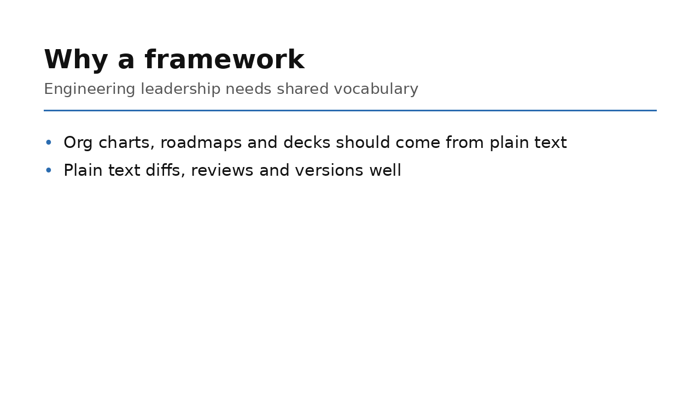

# CTODeck

Present a slide deck from a YAML file in the terminal, or export it as ASCII, PNG, or SVG.



## Install

    pip install -r requirements.txt

Requires Python 3 with `click`, `Pillow`, `PyYAML` and `svgwrite`. `pytest` is only needed to run the tests.

## Data

The data is a YAML mapping with the deck `title` and a list of `slides`:

```yaml
title: CTO Framework
slides:
  - title: Why a framework
    subtitle: Engineering leadership needs shared vocabulary
    content:
      - text: Org charts, roadmaps and decks should come from plain text
      - text: Plain text diffs, reviews and versions well
```

| Field                | Required | Notes                                         |
|----------------------|----------|-----------------------------------------------|
| `title` (deck)       | yes      | Shown on a cover slide that is added first.   |
| `slides`             | yes      | Non-empty list.                               |
| `title` (slide)      | yes      | Heading of the slide.                         |
| `subtitle`           | no       | Shown under the heading.                      |
| `content`            | no       | List of items, drawn as bullets in order.     |
| `content[].text`     | yes      | The text of the item. Long text is wrapped.   |

The loader rejects missing or empty titles, an empty `slides` list, and malformed `content`. See `examples/deck.yaml` for a full example.

## Usage

Present the deck:

    python ctodeck.py [slides.yaml] [--format {interactive,ascii,png,svg}] [-o OUTPUT]

| Format        | Result                                                             |
|---------------|--------------------------------------------------------------------|
| `interactive` | Full-screen ncurses presentation (default).                        |
| `ascii`       | All slides printed to the terminal.                                |
| `png`         | One 1280×720 image per slide, `deck/slide-01.png`, `deck/slide-02.png`… |
| `svg`         | One vector image per slide, `deck/slide-01.svg`…                   |

Keys in interactive mode: `→` `↓` `l` `j` `n` `Space` `Enter` `PgDn` next slide; `←` `↑` `h` `k` `p` `Backspace` `PgUp` previous; `g`/`Home` first; `G`/`End` last; `q`/`Esc` quit.

When stdin or stdout is not a terminal, or `-o` is given, `interactive` falls back to the `ascii` output. `-o` sets the output directory for `png` and `svg`. With `ascii`, it writes plain text to that file instead of printing.

    $ python ctodeck.py examples/deck.yaml --format ascii
    ┌──────────────────────────────────────────────────────────────────────┐
    │ WHY A FRAMEWORK                                                      │
    │ Engineering leadership needs shared vocabulary                       │
    │                                                                      │
    │ • Org charts, roadmaps and decks should come from plain text         │
    │ • Plain text diffs, reviews and versions well                        │
    └──────────────────────────────────────────────────────────────── 2/3 ─┘

## Tests

    pytest

## License

Apache License 2.0. See [LICENSE](LICENSE).
